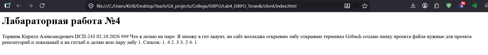

# Заголовок 1

---

## Заголовок 2
**жирный**, *наклон*, ~~зачеркнутый~~, ***моножирный***
---
### Заголовок 3
#### Заголовок 4
##### Заголовок 5
###### Заголовок 6

- авфоа
- аофваоф
- афвоаф

1. вафао
2. 3234
3. 324

1. dfafa
    1. fjadfaj
    2. 32432

>Стены так давят меня в этой комнате, белый потолок засыпаю в холоде, открытые окна в них дует ветер , я не закрывал их, я жду тепла 

```
On branch main
Your branch is up to date with 'origin/main'.

Changes not staged for commit:
  (use "git add/rm <file>..." to update what will be committed)
  (use "git restore <file>..." to discard changes in working directory)
        deleted:    "../\320\241\320\275\320\270\320\274\320\276\320\2721.PNG"

Untracked files:
  (use "git add <file>..." to include in what will be committed)
        ./
        ../repo/

```

|афао|афва|аавоыфа|
|---|---|---|
|dafd|fdaf|adfa|
|dafd|fdaf|adfa|



[Внут](../client/about.html)
[youtube](https://www.youtube.com/)

- [ ] dff
- [x] djfaf

>[!NOTE]
>Жили были бабка детка, сделали они колобка и он одолел человека паука стал злым и тотолитарным...

$a^2 + b^2 = c^2$
$$
\sum_{i=1}^n i = \frac{n(n+1)}{2}
$$
